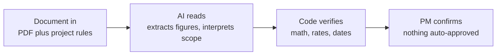
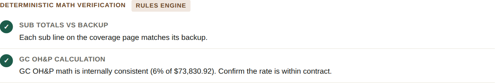
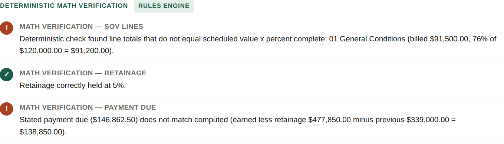
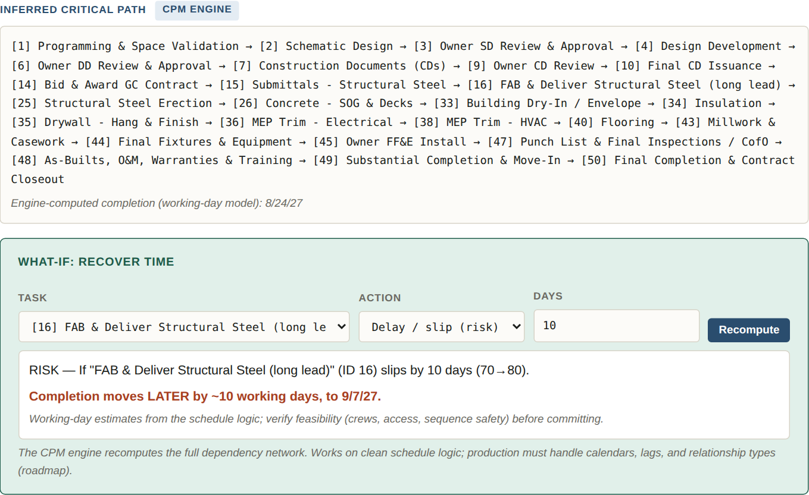

# Construction document review prototypes

Three working prototypes that review the documents every project manager reviews by hand. A change order, a pay application, and a project schedule. I built them on my own time and tested them on documents I constructed.

**[Watch the three tools run](https://www.loom.com/share/94bb247a7c564c8a9e077a4932b79a31)** (video walkthrough)

## The challenge

A change order or a pay application is a stack of pages where the cover sheet has to tie to the backup, the markups have to match the contract, and the scope has to be work the owner actually owes for. Checking that is slow, it repeats every month, and it lands on the project manager alongside everything else. A schedule update carries the same load in a different form.

The review is where money and time get caught. It is also the first thing to get rushed.

## The approach

Each tool does a first review before the project manager picks the document up. It reads the package against the project's own rules, writes its findings in the order they appear in the document, and drafts the note back to the contractor.

Nothing is approved by the tool. Every review ends with what stays the project manager's call.

## The architecture

All three tools share one split.

The model reads the document and returns a structured record of every figure and every possible finding. Plain code then recomputes the arithmetic from those figures against the supplied rules, so the numbers in the review are calculated and not estimated. The schedule tool follows the same split with a critical path engine computing dates from the logic the model extracts.

AI for judgment, code for arithmetic, the person for the decision.

## The three tools

| Tool | What it checks | What it found in the test document |
|---|---|---|
| [Change order reviewer](change-order) | Markup rates against the contract, cover sheet against backup, scope that is really rework, missing backup | Five issues. A contractor fee and a subcontractor markup over the contract caps, two lump sums with no backup, and roofing scope that includes repair of earlier work |
| [Pay application reviewer](pay-application) | Schedule of values math, retainage, unapproved changes, backup, lien waivers, costs that are not allowable | Eleven flags. An unapproved change order billed, a cover sheet that does not tie to the continuation sheet, an invoice from another project, an unsigned ticket, and a missing waiver |
| [Schedule risk analyzer](schedule-risk) | Critical path, long-lead exposure, logic gaps, and what-if scenarios | Permit, switchgear, and steel as the three exposures, plus a what-if showing a ten day steel slip moving completion by ten working days |

Each folder holds the test document, the review the tool produced from it, and the checks the code ran.

### Change order

[Full review](change-order/review.png) and [test document](change-order/test-document.pdf)

### Pay application

[Full review](pay-application/review.png) and [test document](pay-application/test-document.pdf)

### Schedule risk

[Full review](schedule-risk/review.png) and [test document](schedule-risk/test-document.pdf)

## What broke and what I changed

The pay application reviewer broke on long documents until I redesigned how it handles them.

The model sometimes returned a response that cut off partway through a long review. The tools now repair an incomplete response before rendering it, so a reviewer never sees half a review presented as a whole one.

Handed a bare lump sum, an early version tried to produce a finding anyway. The tools now say what they could not check and ask for the backup. A reviewer trusts a tool that admits a gap more than one that guesses.

The first outputs were lists of anomalies. Nobody reviews a package that way, so the findings now run in document order and end with a note that is ready to send.

## What this is and is not

These are prototypes. Each is a single-file browser tool that sends a document to a language model, parses the structured response, and runs the verification in plain code.

They were tested on documents I constructed, with invented names. Real documents, with inconsistent formats and missing backup, will be harder.

The schedule engine uses a simple working-day model. A production version has to handle calendars, lags, and relationship types.

The code cannot guarantee that every figure was read correctly, which is why each review shows its inputs alongside the result.

The source is not in this repo. I am glad to walk through it live.

## Contact

Ryan Prentice, Senior Project Manager, Boston

[rprentice99@gmail.com](mailto:rprentice99@gmail.com) and [LinkedIn](https://www.linkedin.com/in/ryan-prentice-45666b57/)

The thinking behind these tools is in [Where AI belongs in construction project delivery](https://github.com/prentice-builds/ai-in-project-delivery).
